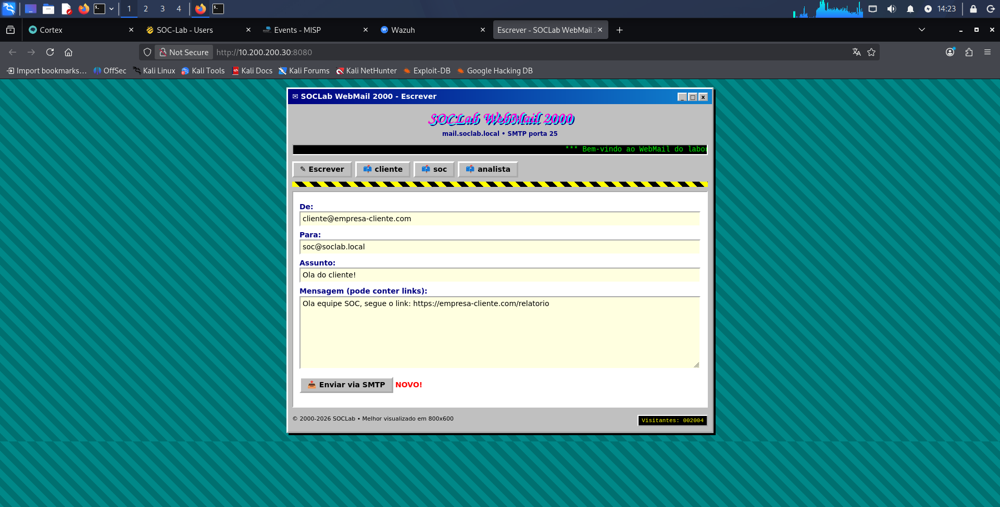
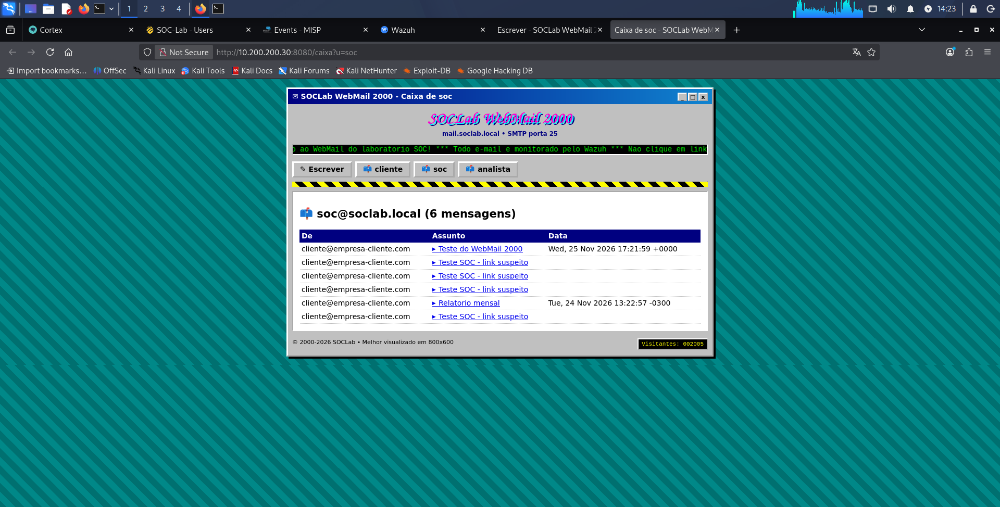

# LABORATÓRIO VIRTUAL DE CENTRO DE OPERAÇÕES DE SEGURANÇA (SOC) PARA MONITORAMENTO DE UM SERVIDOR SMTP

**Autor:** [Nome do aluno]
**Instituição:** [Nome da instituição] — [Curso]
**Disciplina:** [Nome da disciplina] — **Professor(a):** [Nome]
**Local e data:** [Cidade], novembro de 2026

---

> **Em poucas palavras:** quatro máquinas virtuais do VirtualBox formam um pequeno Centro de Operações de Segurança. Um cliente envia e-mails e links a um servidor de e-mail (SMTP, porta 25); um firewall controla a rede; o Wazuh lê os registros do servidor e detecta abusos (tentativas de *relay* e de descobrir usuários); esses alertas chegam automaticamente ao TheHive, onde o analista os investiga com apoio do MISP e do Cortex.
>
> **Quero rodar o laboratório:** veja os [requisitos e o tutorial](#11-distribuição-das-máquinas-virtuais-requisitos-e-tutorial). As VMs prontas estão em [Releases](https://github.com/DanielCMBC/Redes-Laboratorio-de-Telimetria-de-Cyber-Attacks/releases).

---

## RESUMO

Este trabalho documenta a construção de um laboratório virtual de Centro de Operações de Segurança (SOC) em VirtualBox, composto por firewall de próxima geração (OPNsense com Zenarmor), SIEM/XDR (Wazuh), plataforma de gestão de incidentes (TheHive), motor de análise (Cortex), plataforma de inteligência de ameaças (MISP) e uma estação de análise (Kali Linux). O ativo monitorado é um servidor de e-mail SMTP (Postfix) na porta 25, que recebe e-mails e links enviados por um cliente. Os eventos do servidor são coletados pelo agente Wazuh e convertidos em alertas de segurança, como tentativas de *relay* e enumeração de usuários. O documento descreve a arquitetura, o endereçamento, o software instalado em cada máquina virtual, a ordem de inicialização, os testes realizados, os problemas encontrados e as soluções adotadas.

**Palavras-chave:** SOC. SIEM. Wazuh. TheHive. SMTP. Postfix. OPNsense.

---

## SUMÁRIO

1. [Introdução](#1-introdução)
2. [Objetivos](#2-objetivos)
3. [Arquitetura do laboratório](#3-arquitetura-do-laboratório)
4. [Descrição das máquinas virtuais](#4-descrição-das-máquinas-virtuais)
5. [Como iniciar o laboratório](#5-como-iniciar-o-laboratório)
6. [Servidor SMTP monitorado](#6-servidor-smtp-monitorado)
7. [Integrações entre as ferramentas](#7-integrações-entre-as-ferramentas)
8. [Problemas encontrados e soluções](#8-problemas-encontrados-e-soluções)
9. [Segurança e credenciais](#9-segurança-e-credenciais)
10. [Estrutura do repositório](#10-estrutura-do-repositório)
11. [Distribuição das VMs, requisitos e tutorial](#11-distribuição-das-máquinas-virtuais-requisitos-e-tutorial)
12. [Considerações finais](#12-considerações-finais)
- [Referências](#referências)

---

## 1 INTRODUÇÃO

Um SOC reúne pessoas, processos e ferramentas para detectar, analisar e responder a incidentes de segurança. Este laboratório reproduz, em pequena escala, os componentes de um SOC real e os aplica a um cenário concreto: proteger um **servidor de e-mail SMTP** que recebe mensagens de um cliente externo. O e-mail é um dos principais vetores de ataque (phishing, links maliciosos, abuso como *relay* de spam), o que justifica o monitoramento contínuo desse serviço.

O laboratório foi construído com base na série de vídeos *Virtual Lab Building Series* (ver Referências), **atualizada para as versões atuais** das ferramentas (novembro de 2026). Diversas etapas dos vídeos não funcionam mais como mostrado; as adaptações estão descritas na Seção 8.

## 2 OBJETIVOS

### 2.1 Objetivo geral

Implantar um SOC virtual capaz de monitorar um servidor SMTP na porta 25 e gerar alertas de segurança a partir do seu tráfego.

### 2.2 Objetivos específicos

1. Segmentar a rede do laboratório com um firewall OPNsense com duas saídas de internet (*multi-WAN*) e inspeção de tráfego (Zenarmor).
2. Centralizar logs e alertas no Wazuh (SIEM/XDR).
3. Implantar TheHive, Cortex e MISP com Docker para gestão de casos, análise de observáveis e inteligência de ameaças.
4. Disponibilizar um servidor SMTP (Postfix) que recebe e-mails de um cliente e registrar suas atividades.
5. Simular comportamentos legítimos e maliciosos de um cliente e verificar a detecção no Wazuh.

## 3 ARQUITETURA DO LABORATÓRIO

### 3.1 Topologia

```
                        Internet (via NAT do VirtualBox)
                 ISPSim1 10.0.2.0/24          ISPSim2 10.0.3.0/24
                        |                             |
                   WAN 10.0.2.10                WAN2 10.0.3.10
                 +---------------------------------------------+
                 |  OPNsense 26.7.9 + Zenarmor (firewall/NGFW) |
                 +---------------------------------------------+
                                LAN 10.200.200.254
                                        |
        ============ Rede interna "intnet" 10.200.200.0/24 ============
             |                         |                          |
     Kali Linux                 Wazuh 4.14.10               Ubuntu_Server 24.04
     10.200.200.10              10.200.200.20               10.200.200.30
     (analista e cliente)       (SIEM/XDR)                  TheHive, Cortex, MISP
                                    |                       + SMTP Postfix :25
                       host-only 192.168.56.20
                                    |
                     Windows (hospedeiro) 192.168.56.1
```

### 3.2 Plano de endereçamento

| Máquina | Função | Interface / Rede VirtualBox | Endereço IP |
|---|---|---|---|
| OpnSense | Firewall / roteador | WAN (em0) – NAT Network `ISPSim1` | 10.0.2.10/24, gateway 10.0.2.1 |
| OpnSense | Firewall / roteador | WAN2 (em2) – NAT Network `ISPSim2` | 10.0.3.10/24, gateway 10.0.3.1 |
| OpnSense | Firewall / roteador | LAN (em1) – Internal Network `intnet` | **10.200.200.254/24** (gateway e DNS da LAN) |
| Kali Linux | Estação do analista / cliente simulado | `intnet` | 10.200.200.10/24 |
| Wazuh | SIEM/XDR | `intnet` | 10.200.200.20/24 |
| Wazuh | Acesso a partir do Windows | Host-only | 192.168.56.20/24 |
| Ubuntu_Server | SOC (Docker) + servidor SMTP | `intnet` | 10.200.200.30/24 |

A rede `intnet` não possui servidor DHCP: todas as máquinas usam **IP estático**, com gateway e DNS apontando para o OPNsense (10.200.200.254).

### 3.3 Recursos das máquinas virtuais

| Máquina | Sistema | vCPU | RAM | Pasta no disco |
|---|---|---|---|---|
| OpnSense | OPNsense 26.7.9 (FreeBSD) | 2 | 2 GB | `D:\OpnSense` |
| Wazuh v4.14.10 OVA | Amazon Linux 2023 | 4 | 3 GB | `D:\Wazuh v4.14.10 OVA` |
| Ubuntu_Server | Ubuntu Server 24.04.5 LTS | 4 | 8 GB | `D:\Ubuntu_Server` |
| Kali Linux | Kali Linux 2026.3 | 1 | 2 GB | `D:\Kali Linux` |
| OpnSense Backup | OPNsense, firewall secundário da HA (opcional, não utilizado no cenário do SMTP) | 2 | 2 GB | `D:\OpnSense Backup` |

Hospedeiro: Windows 10, AMD Ryzen 5 5500 (12 threads), 16 GB de RAM, VirtualBox 7.2.

## 4 DESCRIÇÃO DAS MÁQUINAS VIRTUAIS

### 4.1 OpnSense — firewall de próxima geração

- **Função:** roteador e firewall entre a LAN do laboratório e a internet; único gateway da rede `intnet`.
- **Software:** OPNsense 26.7.9; plugin **Zenarmor 2.7.2** (os-sensei, via repositório os-sunnyvalley); proxy web com inspeção SSL.
- **Configurações principais:**
  - **Multi-WAN:** gateways `WAN_GW` (10.0.2.1, monitora 1.1.1.1, prioridade 1) e `WAN2_GW` (10.0.3.1, monitora 9.9.9.9, prioridade 2); grupo de failover `GW_GROUP` (WAN → WAN2) e grupo de balanceamento `GW_LOADBALANCE`. As WANs usam IP estático para que o monitoramento detecte a queda do provedor.
  - **Regra LAN para o próprio firewall sem roteamento por política**, para que DNS e interface web não sejam enviados para a WAN.
  - **Zenarmor:** modo *Routed (L3) com driver netmap emulado*, protegendo a interface LAN (em1), banco de dados SQLite. Os *hardware offloads* (CRC, TSO, LRO) foram desativados em *Interfaces → Settings*, exigência do Zenarmor.
  - **Proxy transparente com inspeção HTTPS** (CA `opnsensewebca`). O servidor 10.200.200.30 está **isento** da interceptação por uma regra *No RDR* em *Firewall → NAT → Destination NAT* (sequência 100, antes das regras de redirecionamento), porque os contêineres do SOC não confiam na CA do proxy.
- **Acesso:** `http://10.200.200.254` (a partir da LAN).

### 4.2 Kali Linux — estação do analista e cliente simulado

- **Função:** acesso às interfaces web do SOC e simulação do **cliente** que envia e-mails ao servidor SMTP.
- **Software adicional:** agente Wazuh 4.14.10 (nome `kali`); `swaks` (cliente SMTP de testes, já incluso no Kali).
- **Script:** `kali/simular-cliente-smtp.sh` (e-mails legítimos, anexo, tentativas de *relay* e enumeração de usuários).
- **Observações:** IP estático configurado no NetworkManager; protetor de tela e bloqueio automático desativados.

### 4.3 Wazuh — SIEM/XDR

- **Função:** coleta de logs, correlação e geração de alertas; painel de visualização.
- **Software:** Wazuh 4.14.10 (OVA oficial: manager, indexer e dashboard) sobre Amazon Linux 2023.
- **Rede:** systemd-networkd; os arquivos de configuração estão associados ao **endereço MAC** de cada placa (ver `rede/`).
- **Agentes registrados:**

| ID | Nome | Máquina | Situação |
|---|---|---|---|
| 001 | MPC | Windows hospedeiro (via 192.168.56.20) | Ativo |
| 002 | kali | Kali Linux | Ativo |
| 003 | smtp-server | Ubuntu_Server (lê o log do Postfix) | Ativo |

- **Acesso:** `https://10.200.200.20` (LAN) ou `https://192.168.56.20` (Windows).

### 4.4 Ubuntu_Server — plataforma SOC e servidor SMTP

- **Função:** hospeda, em Docker, TheHive, Cortex, MISP e o **servidor SMTP monitorado**.
- **Software base:** Ubuntu Server 24.04.5; Docker Engine 29.10; Docker Compose 5.7.1; agente Wazuh 4.14.10 (`smtp-server`). A CA `opnsensewebca` do proxy foi adicionada às CAs confiáveis do sistema.

| Pilha (pasta) | Contêiner | Imagem / versão | Porta publicada |
|---|---|---|---|
| `~/soc/thehive` | thehive | strangebee/thehive:5.4 (5.4.11) | 9000 |
| | cortex | thehiveproject/cortex:3.1.8 | 9001 |
| | cassandra | cassandra:4.1 | — |
| | elasticsearch | elasticsearch:7.17.24 | — |
| | minio | pgsty/minio (build comunitário do MinIO) | 9090 (console) |
| `~/soc/misp` | misp-core, misp-modules, misp-nginx, db (MariaDB 10.11), redis (Valkey 7.2), mail | ghcr.io/misp/misp-docker (MISP 2.5.51) | 80, 443 |
| `~/soc/mail` | smtp-server | soclab/postfix:1.0 (Ubuntu 24.04 + Postfix) | **25** |
| | webmail | soclab/webmail:1.0 (Python 3.12, interface Y2K) | 8080 |

- **Acesso:** TheHive `http://10.200.200.30:9000`; Cortex `http://10.200.200.30:9001`; MISP `https://10.200.200.30`; MinIO `http://10.200.200.30:9090`; SMTP `10.200.200.30:25`; WebMail `http://10.200.200.30:8080`.

## 5 COMO INICIAR O LABORATÓRIO

### 5.1 Ordem de inicialização

1. **OpnSense** — aguardar o menu do console (cerca de 1 minuto). Sem ele, nenhuma VM tem internet.
2. **Wazuh** — aguardar 2 a 3 minutos (indexer e dashboard).
3. **Ubuntu_Server** — os contêineres sobem sozinhos (`restart: unless-stopped`); o TheHive leva de 1 a 3 minutos.
4. **Kali Linux** — usar o Firefox para acessar as interfaces.

> O disco externo com as VMs deve estar montado como **D:** antes de abrir o VirtualBox; caso contrário, as VMs aparecem como *inacessíveis*.
>
> Com 16 GB de RAM no hospedeiro, as quatro VMs juntas (≈15 GB) esgotam a memória e o VirtualBox pode desligar o Wazuh. Para demonstrações, desligue o OPNsense (quando não for necessário acesso à internet) ou o Kali.

### 5.2 Verificação no Ubuntu_Server

```bash
cd /home/daniel/soc/thehive && docker compose ps     # cassandra e elasticsearch: (healthy)
cd /home/daniel/soc/misp    && docker compose ps     # todos (healthy)
cd /home/daniel/soc/mail    && docker compose ps     # smtp-server (25) e webmail (8080): Up
systemctl is-active wazuh-agent                      # active
```

### 5.3 Comandos úteis

| Objetivo | Comando (na pasta da pilha) |
|---|---|
| Iniciar | `docker compose up -d` |
| Parar (mantém os dados) | `docker compose down` |
| Ver estado e saúde | `docker compose ps` |
| Ver logs | `docker compose logs --tail 50 <serviço>` |

> Não use `docker compose down -v`: a opção `-v` apaga os volumes (dados).

## 6 SERVIDOR SMTP MONITORADO

### 6.1 Configuração

O Postfix roda em um contêiner construído a partir de `mail/Dockerfile`, com a configuração aplicada em `mail/entrypoint.sh`:

- domínio `soclab.local`, nome `mail.soclab.local`, escuta em todas as interfaces na **porta 25**;
- caixas postais locais: `cliente`, `soc` e `analista`;
- **não é um relay aberto:** aceita apenas mensagens destinadas a `@soclab.local` (`smtpd_relay_restrictions = permit_mynetworks, reject_unauth_destination`, com `mynetworks` restrito a 127.0.0.0/8);
- `smtpd_helo_required = yes` e `disable_vrfy_command = yes` (dificulta a enumeração de usuários);
- log no formato padrão do Postfix em `/home/daniel/soc/mail/logs/mail.log`, lido pelo agente Wazuh (`mail/instalar-wazuh-agent.sh`).

Para construir e iniciar:

```bash
cd /home/daniel/soc/mail
docker compose up -d --build
```

### 6.2 Testes realizados

Executados no servidor (`mail/testar-smtp.sh`) e a partir do Kali, como cliente externo (`kali/simular-cliente-smtp.sh`):

| Teste | Resultado esperado | Resultado obtido |
|---|---|---|
| E-mail para `soc@soclab.local` com link | Aceito e entregue | `status=sent (delivered to mailbox)` |
| E-mail com anexo para `analista@soclab.local` | Aceito | Enviado |
| *Relay* para gmail.com, outlook.com e yahoo.com | Recusado | `554 5.7.1 Relay access denied` |
| Destinatários inexistentes (admin, teste, rh...) | Recusado | `550 5.1.1 Recipient address rejected` |

### 6.3 Alertas gerados no Wazuh (agente `smtp-server`)

| Regra | Nível | Descrição | Ocorrências |
|---|---|---|---|
| 3301 | 6 | Postfix: Attempt to use mail server as relay (client host rejected) | 3 |
| 3302 | 6 | Postfix: Rejected by access list (Requested action not taken) | 6 |

Os alertas correspondem exatamente às tentativas de *relay* e de enumeração enviadas pelo Kali, demonstrando a detecção ponta a ponta. O agente também executa a avaliação de configuração (*CIS Ubuntu 24.04 Benchmark*) do servidor.

### 6.4 Interface web (SOCLab WebMail 2000)

Para facilitar a demonstração, foi criada uma interface web simples em HTML5, com visual inspirado nos sites dos anos 2000 (Y2K), acessível em **`http://10.200.200.30:8080`** a partir do Kali:

- **Escrever:** formulário (De, Para, Assunto, Mensagem com links) que envia o e-mail **pelo protocolo SMTP, porta 25**, ao contêiner do Postfix. Se o destinatário for externo, a página exibe a recusa do servidor (`554 5.7.1 Relay access denied`), que também gera alerta no Wazuh.
- **Caixas postais:** leitura das caixas `cliente`, `soc` e `analista` (somente leitura), com destaque para os **links encontrados** nas mensagens e para anexos.
- **Implementação:** Python 3.12 apenas com a biblioteca padrão (`http.server`, `smtplib`, `mailbox`), em contêiner próprio (`mail/webmail/`); todo conteúdo exibido é escapado e a página envia cabeçalhos `Content-Security-Policy` e `X-Content-Type-Options`.
- **Limitação:** e-mails enviados pela interface chegam ao Postfix a partir do IP interno do contêiner (rede Docker 172.20.0.0/16), e não do IP do usuário; para testes de origem, use o `swaks` no Kali.

| Escrever | Caixa postal |
|---|---|
|  |  |

Observação: o destinatário `root@soclab.local` foi **aceito**, pois a conta `root` existe em qualquer sistema Linux. Em produção, recomenda-se criar um alias que redirecione `root` para a equipe responsável.

## 7 INTEGRAÇÕES ENTRE AS FERRAMENTAS

| Integração | Situação | Detalhes |
|---|---|---|
| TheHive ↔ MISP | **Concluída** | Conector `MISP-Lab` (`https://10.200.200.30`), importação e exportação, eventos dos últimos 30 dias; teste de conexão aprovado. O TheHive confia no certificado do MISP por meio de um *truststore* Java próprio (`soc-thehive/criar-truststore.sh`). |
| TheHive ↔ Cortex | Pendente | O contêiner `cortex` está acessível pelo TheHive em `http://cortex:9001`; falta cadastrar a chave de API de um usuário do Cortex no conector. |
| Wazuh → TheHive (episódio 13) | **Concluída** | Ver Seção 7.1. Alertas do grupo `postfix` viram alertas no TheHive (HTTP 201 confirmado). |
| Analisadores do Cortex (episódio 12) | Pendente | Acesso do Cortex à internet já liberado (Seção 8). |
| Zenarmor → Wazuh via Syslog | Pendente | — |
| Agentes Wazuh (Windows, Kali, SMTP) | **Concluída** | Ver Seção 4.3. |

### 7.1 Integração Wazuh → TheHive (episódio 13, atualizada)

O vídeo original usa a biblioteca `thehive4py` antiga (TheHive 4). Para o TheHive 5.4 foi escrito um script próprio, sem dependências externas, que usa a API v1 (`POST /api/v1/alert`):

1. **No TheHive:** organização `SOC-Lab` e usuário de **serviço** `wazuh@soclab.local`, perfil `analyst` (permissão `manageAlert/create`), com chave de API. A organização `admin` não pode receber alertas, por isso foi criada uma organização própria.
2. **No Wazuh:** `wazuh-thehive/custom-w2thive.py` copiado para `/var/ossec/integrations/` (o *launcher* `custom-w2thive` é uma cópia do `slack` que acompanha o Wazuh) e o bloco abaixo adicionado ao `/var/ossec/etc/ossec.conf` pelo script `wazuh-thehive/instalar-integracao.sh`, que pede a chave sem exibi-la:

```xml
<integration>
  <name>custom-w2thive</name>
  <hook_url>http://10.200.200.30:9000</hook_url>
  <api_key>CHAVE_DO_USUARIO_WAZUH_NO_THEHIVE</api_key>
  <group>postfix,</group>
  <alert_format>json</alert_format>
</integration>
```

3. **Mapeamento:** título `[Wazuh] <descrição da regra>`; severidade derivada do nível da regra (até 6 = baixa, 7–9 = média, 10–12 = alta, 13+ = crítica); *tags* `wazuh`, `rule:<id>`, `agent:<nome>` e grupos da regra; o IP de origem (`srcip`) vira observável do tipo `ip`; o log original vai na descrição.
4. **Resultado:** ao repetir os ataques de *relay* e de destinatário inexistente, o log `/var/ossec/logs/integrations.log` registrou `enviado ao TheHive: HTTP 201` para cada alerta, que aparecem em **Alerts** da organização `SOC-Lab`.

Para trocar a chave posteriormente: `sudo bash trocar-chave.sh` no Wazuh. Observação: ao colar a chave, alguns terminais inserem um caractere invisível (`\r`); o script de integração remove espaços e quebras de linha da chave para evitar o erro *Invalid header value*.

## 8 PROBLEMAS ENCONTRADOS E SOLUÇÕES

| Problema | Causa | Solução adotada |
|---|---|---|
| HA entre os dois OPNsense não sincronizava | Senha CARP diferente no VIP da LAN; interface pfsync sem regra de firewall | Senhas igualadas; regra de liberação na interface PFSYNC |
| Failover multi-WAN não ocorria | Com WAN em DHCP, o monitoramento do gateway saía pela WAN2 | WANs com IP estático e monitoramento de IPs externos (1.1.1.1 e 9.9.9.9) |
| Zenarmor recusava a interface | *Hardware offloading* ativo; no OPNsense 26.7 a opção mudou de lugar na configuração | Offloading desativado no local correto (*Interfaces → Settings*) |
| Downloads HTTPS falhavam no Ubuntu e nos contêineres | Proxy transparente com inspeção SSL (CA `opnsensewebca`) | CA adicionada ao Ubuntu e regra *No RDR* para 10.200.200.30 **posicionada antes** das regras de proxy |
| `minio/minio` não existe mais no Docker Hub | O projeto MinIO deixou de publicar a imagem comunitária | Uso da imagem `pgsty/minio` (build comunitário com os mesmos comandos) |
| `misp-modules` "unhealthy" | Verificação de saúde com prazo muito curto | Novo `docker compose up -d` após o carregamento dos módulos |
| `misp-nginx` reiniciando | Versões novas exigem certificado próprio; permissões do arquivo de chave | `soc-misp/gerar-certificado-misp.sh` (certificado autoassinado para 10.200.200.30, grupo 101) |
| Conector MISP do TheHive falhava | Campo *Maximum age* sem unidade selecionada | Selecionar a unidade (*days*) |
| Placas de rede trocaram de nome no Wazuh | Ao adicionar a placa host-only, eth0 e eth1 inverteram | Configuração de rede associada ao endereço MAC |
| IP duplicado (Kali e Wazuh em .20) | IP configurado manualmente no Kali | Kali restaurado para 10.200.200.10 pelo NetworkManager |
| VMs "inacessíveis" | Outro disco externo assumiu a letra D: | Reconectar o disco do laboratório como D: |
| Wazuh desligado sozinho ("Failed to procure handy pages") | Memória do hospedeiro esgotada com as quatro VMs ligadas | Desligar temporariamente o OPNsense (Wazuh e TheHive se comunicam direto na `intnet`) ou o Kali |
| Integração Wazuh → TheHive com erro HTTP 401 | Chave errada colada (chave do MISP na área de transferência) | Script `trocar-chave.sh` e conferência do tamanho da chave (32 caracteres) |
| Erro *Invalid header value* | Caractere `\r` invisível colado junto com a chave | Remoção de espaços na configuração e `strip()` no script |

## 9 SEGURANÇA E CREDENCIAIS

- **Nenhuma senha ou chave está neste repositório.** Os arquivos `.env` reais ficam apenas no servidor (`/home/daniel/soc/thehive/.env` e `/home/daniel/soc/misp/.env`, permissão 600); use `soc-thehive/.env.example` como modelo.
- Trocar as senhas padrão: TheHive (`admin@thehive.local`), Wazuh (`admin`), MISP (`admin@admin.test`) e o usuário `wazuh-user` do Wazuh.
- As chaves de API (MISP para o TheHive; TheHive para o Wazuh) devem ser criadas com o menor privilégio necessário e revogadas ao final do trabalho.
- O servidor SMTP não é um relay aberto e recusa destinatários inexistentes.
- Durante a configuração, duas tentativas com chave inválida registraram a chave no arquivo `/var/ossec/logs/integrations.log` do Wazuh. Ao final do trabalho, recomenda-se **renovar a chave** do usuário `wazuh@soclab.local` no TheHive (*Renew*) e atualizá-la com `trocar-chave.sh`.

## 10 ESTRUTURA DO REPOSITÓRIO

```
.
├── README.md                     este documento
├── .gitignore                    impede o envio de segredos, logs e discos de VM
├── mail/                         servidor SMTP (Postfix) monitorado
│   ├── Dockerfile
│   ├── entrypoint.sh             configuração do Postfix
│   ├── docker-compose.yml
│   ├── testar-smtp.sh            testes locais (aceito / relay / inexistente)
│   ├── instalar-wazuh-agent.sh   agente Wazuh + leitura do mail.log
│   └── webmail/                  interface web Y2K (Dockerfile + app.py)
├── docs/                         capturas de tela do WebMail
├── kali/
│   └── simular-cliente-smtp.sh   simulação do cliente (swaks)
├── soc-thehive/                  TheHive 5.4 + Cortex + Cassandra + Elasticsearch + MinIO
│   ├── docker-compose.yml
│   ├── .env.example
│   └── criar-truststore.sh       confiança no certificado do MISP
├── soc-misp/                     MISP (projeto oficial misp-docker)
│   ├── gerar-certificado-misp.sh
│   └── env-alteracoes.txt
├── wazuh-thehive/                integração Wazuh -> TheHive (episódio 13)
│   ├── custom-w2thive.py         envia alertas à API v1 do TheHive
│   ├── instalar-integracao.sh    instala o script e o bloco <integration>
│   └── trocar-chave.sh           troca a chave de API
└── rede/                         configurações de rede estática
    ├── ubuntu-server-01-netcfg.yaml
    ├── wazuh-20-lan.network
    └── wazuh-30-hostonly.network
```

## 11 DISTRIBUIÇÃO DAS MÁQUINAS VIRTUAIS, REQUISITOS E TUTORIAL

O GitHub não aceita arquivos maiores que 100 MB no repositório, e os discos das VMs ocupam vários gigabytes. Por isso, as VMs foram exportadas pelo VirtualBox no formato `.ova`, divididas em partes de 1,9 GB e publicadas na página de **Releases** do repositório:

- **VMs prontas:** https://github.com/DanielCMBC/Redes-Laboratorio-de-Telimetria-de-Cyber-Attacks/releases

O código deste repositório (pastas `mail/`, `soc-thehive/` etc.) é o mesmo que está dentro das VMs; ele serve para consulta ou para reconstruir o ambiente do zero.

### 11.1 Requisitos

| Item | Mínimo | Recomendado |
|---|---|---|
| Processador | 64 bits, 4 núcleos, com virtualização ativada na BIOS (Intel VT-x ou AMD-V) | 6 núcleos / 12 *threads* |
| Memória RAM | 16 GB (rodar no máximo 3 VMs ao mesmo tempo, ver Seção 5.1) | 32 GB (as 4 VMs juntas) |
| Espaço em disco | 150 GB livres (partes baixadas + OVAs + VMs importadas) | SSD com 200 GB livres |
| Sistema do hospedeiro | Windows 10/11 ou Linux de 64 bits | — |
| Software | **Oracle VirtualBox 7.2** ou mais novo | VirtualBox Extension Pack (opcional) |
| Internet | Necessária apenas para baixar as VMs e para atualizações dentro delas | — |

> Depois de importar as VMs, as partes baixadas e os arquivos `.ova` podem ser apagados para liberar espaço.

### 11.2 Arquivos do Release

| VM | Arquivo após juntar as partes | Função |
|---|---|---|
| OpnSense | `OpnSense.ova` | Firewall, roteador e gateway da LAN |
| Wazuh | `Wazuh.ova` | SIEM/XDR |
| Ubuntu_Server | `Ubuntu_Server.ova` | TheHive, Cortex, MISP, servidor SMTP e WebMail |
| Kali Linux | `Kali_Linux.ova` | Estação do analista e cliente que envia os e-mails |
| OpnSense Backup | `OpnSense_Backup.ova` | Firewall secundário da alta disponibilidade (CARP/pfsync); **opcional**, não é usado no cenário do SMTP |

A VM **OpnSense Backup** usa a rede NAT `InternetSim` na WAN e a rede interna `pfsync` para sincronizar com o firewall principal. Para usá-la, crie também a rede NAT `InternetSim` (Passo 5). Ela não é necessária para a demonstração do servidor SMTP.

Cada `.ova` foi dividido em partes numeradas (`Nome.ova.001`, `Nome.ova.002`...). O arquivo `SHA256SUMS.txt` contém o código de verificação de cada `.ova` completo.

### 11.3 Tutorial passo a passo

**Passo 1 — Instalar o VirtualBox.** Baixe em https://www.virtualbox.org/wiki/Downloads e instale com as opções padrão. Confirme na BIOS/UEFI que a virtualização (VT-x/AMD-V) está ativada.

**Passo 2 — Baixar as partes.** Na página de Releases, baixe **todas** as partes de cada VM e o arquivo `SHA256SUMS.txt` para uma mesma pasta (por exemplo, `C:\SOCLab`).

**Passo 3 — Juntar as partes.** As partes precisam ser unidas na ordem correta.

No Windows (PowerShell, dentro da pasta das partes):

```powershell
foreach ($vm in 'OpnSense','Wazuh','Ubuntu_Server','Kali_Linux','OpnSense_Backup') {
  $partes = Get-ChildItem "$vm.ova.*" | Sort-Object Name
  $saida = [IO.File]::Create("$PWD\$vm.ova")
  foreach ($p in $partes) { $in = [IO.File]::OpenRead($p.FullName); $in.CopyTo($saida); $in.Close() }
  $saida.Close()
}
```

No Linux:

```bash
for vm in OpnSense Wazuh Ubuntu_Server Kali_Linux OpnSense_Backup; do cat "$vm".ova.0* > "$vm".ova; done
```

**Passo 4 — Verificar a integridade.** Compare o resultado com o `SHA256SUMS.txt`. Se algum código for diferente, baixe novamente as partes daquela VM.

```powershell
Get-FileHash *.ova -Algorithm SHA256 | Format-Table Hash, Path
```

```bash
sha256sum -c SHA256SUMS.txt
```

**Passo 5 — Criar as redes do VirtualBox.** As VMs dependem de três redes. No VirtualBox, abra *Arquivo → Ferramentas → Gerenciador de Rede* (*Network Manager*):

| Aba | Nome | Configuração |
|---|---|---|
| NAT Networks | `ISPSim1` | Prefixo `10.0.2.0/24` (DHCP pode ficar ativado; o OPNsense usa IP fixo) |
| NAT Networks | `ISPSim2` | Prefixo `10.0.3.0/24` (idem) |
| Host-only Networks | (nome gerado automaticamente) | `192.168.56.1/24`, DHCP desativado |

A rede interna `intnet` (LAN do laboratório) não precisa ser criada: o VirtualBox a cria sozinho quando a primeira VM liga. As mesmas redes podem ser criadas por linha de comando:

```powershell
cd "C:\Program Files\Oracle\VirtualBox"
.\VBoxManage natnetwork add --netname ISPSim1 --network 10.0.2.0/24 --enable
.\VBoxManage natnetwork add --netname ISPSim2 --network 10.0.3.0/24 --enable
.\VBoxManage hostonlyif create
.\VBoxManage hostonlyif ipconfig "VirtualBox Host-Only Ethernet Adapter" --ip 192.168.56.1 --netmask 255.255.255.0
```

**Passo 6 — Importar as VMs.** Em *Arquivo → Importar Appliance*, selecione cada `.ova` e clique em *Finalizar*. Em *Política de endereço MAC*, escolha **"Incluir todos os endereços MAC das placas de rede"**: o Wazuh identifica as placas pelo MAC (Seção 4.3) e o OPNsense pelo nome da interface.

**Passo 7 — Conferir as placas de rede de cada VM** (*Configurações → Rede*):

| VM | Adaptador 1 | Adaptador 2 | Adaptador 3 |
|---|---|---|---|
| OpnSense | Rede NAT `ISPSim1` (WAN) | Rede interna `intnet` (LAN) | Rede NAT `ISPSim2` (WAN2) |
| Wazuh | Rede interna `intnet` | Placa só de hospedeiro (host-only) | — |
| Ubuntu_Server | Rede interna `intnet` | — | — |
| Kali Linux | Rede interna `intnet` | — | — |

Se o VirtualBox avisar que a placa host-only "não existe", selecione a placa criada no Passo 5.

**Passo 8 — Ajustar a memória (se o computador tiver 16 GB).** Mantenha os valores da Seção 3.3, mas não ligue as quatro VMs ao mesmo tempo. Para a demonstração do SMTP bastam **Wazuh + Ubuntu_Server + Kali**; o OPNsense só é necessário para acesso à internet.

**Passo 9 — Ligar as VMs na ordem da Seção 5.1** (OpnSense → Wazuh → Ubuntu_Server → Kali) e aguardar o tempo indicado para cada uma.

**Passo 10 — Fazer login.** As senhas das VMs e das aplicações **não são publicadas** neste repositório (Seção 9); solicite-as ao autor. Recomenda-se trocá-las no primeiro acesso.

**Passo 11 — Acessar as interfaces pelo Firefox do Kali:**

| Ferramenta | Endereço |
|---|---|
| OPNsense | http://10.200.200.254 |
| Wazuh | https://10.200.200.20 (ou https://192.168.56.20 a partir do Windows) |
| TheHive | http://10.200.200.30:9000 |
| Cortex | http://10.200.200.30:9001 |
| MISP | https://10.200.200.30 |
| WebMail | http://10.200.200.30:8080 |

Os certificados do Wazuh e do MISP são autoassinados: aceite o aviso do navegador (*Avançado → Aceitar o risco*).

**Passo 12 — Demonstração ponta a ponta.**

1. No Kali, abra o WebMail (`http://10.200.200.30:8080`) e envie um e-mail com link para `soc@soclab.local`. Confira a mensagem em *Caixa → soc*.
2. Envie outro e-mail para um destinatário externo (por exemplo, `alguem@gmail.com`): o servidor responde `554 5.7.1 Relay access denied`.
3. Ou, no terminal do Kali, rode o cenário completo do cliente: `bash kali/simular-cliente-smtp.sh`.
4. No **Wazuh**, abra *Threat Hunting*, filtre por `agent.name: smtp-server` e veja os alertas das regras **3301** (relay) e **3302** (destinatário recusado).
5. No **TheHive** (organização `SOC-Lab`), abra **Alerts**: cada alerta do Wazuh aparece como `[Wazuh] ...`, com o IP de origem como observável.

### 11.4 Solução de problemas na instalação

| Sintoma | Solução |
|---|---|
| "VT-x/AMD-V não disponível" ao ligar uma VM | Ativar a virtualização na BIOS; no Windows, desativar o Hyper-V/Memory Integrity se necessário |
| Erro ao importar: espaço insuficiente | Liberar espaço ou importar em outro disco (*Pasta base da máquina* na tela de importação) |
| A VM não encontra a rede `ISPSim1`/`ISPSim2` | Criar as redes NAT do Passo 5 com o nome exato |
| Kali não abre as interfaces | Conferir se a VM está na rede `intnet` e se o Ubuntu_Server terminou de iniciar (`docker compose ps`) |
| TheHive mostra "Functionality unavailable" | Aguardar 1 a 3 minutos após ligar o Ubuntu_Server e atualizar a página (F5) |
| Wazuh desliga sozinho | Memória insuficiente: desligue o OPNsense ou reduza a RAM do Ubuntu_Server para 6 GB |
| Teclado com símbolos trocados no OPNsense | No console, digitar `kbdcontrol -l us` (ou o layout desejado) |

## 12 CONSIDERAÇÕES FINAIS

O laboratório cumpre o objetivo principal: o servidor SMTP na porta 25 recebe e-mails e links de um cliente, e as tentativas de abuso (*relay* e enumeração de usuários) são detectadas pelo Wazuh em tempo real. Esses alertas são enviados automaticamente ao TheHive, onde viram alertas com o IP do atacante como observável, e o TheHive está integrado à inteligência de ameaças (MISP). Como trabalhos futuros, ficam a habilitação de analisadores do Cortex para examinar links e anexos recebidos por e-mail e o envio dos logs do Zenarmor ao Wazuh via Syslog.

---

## REFERÊNCIAS

DECISO. **OPNsense documentation**. [S. l.], 2026. Disponível em: https://docs.opnsense.org. Acesso em: 25 nov. 2026.

DOCKER INC. **Install Docker Engine on Ubuntu**. [S. l.], 2026. Disponível em: https://docs.docker.com/engine/install/ubuntu/. Acesso em: 25 nov. 2026.

HOW to Integrate Wazuh & TheHive - Virtual Lab Building Series Ep: 13. [S. l.: s. n.], [2024?]. 1 vídeo. Disponível em: https://www.youtube.com/watch?v=t51xiE4MAZg. Acesso em: 25 nov. 2026.

HOW to enable Cortex analyzers - Virtual Lab Building Series: Ep12. [S. l.: s. n.], [2024?]. 1 vídeo. Disponível em: https://www.youtube.com/watch?v=YuMn02vTe5k. Acesso em: 25 nov. 2026.

HOW VirtualBox 7.0 networking works - NAT, NAT Network, Internal Network, Bridged Adapter. [S. l.: s. n.], [2024?]. 1 vídeo. Disponível em: https://www.youtube.com/watch?v=Fhdxk4bmJCs. Acesso em: 25 nov. 2026.

MISP PROJECT. **MISP Docker**. [S. l.], 2026. Disponível em: https://github.com/MISP/misp-docker. Acesso em: 25 nov. 2026.

ORACLE. **Oracle VirtualBox User Manual**. [S. l.], 2026. Disponível em: https://www.virtualbox.org/manual/. Acesso em: 25 nov. 2026.

POSTFIX. **Postfix documentation**. [S. l.], 2026. Disponível em: https://www.postfix.org/documentation.html. Acesso em: 25 nov. 2026.

STRANGEBEE. **TheHive 5 documentation**. [S. l.], 2026. Disponível em: https://docs.strangebee.com. Acesso em: 25 nov. 2026.

SUNNY VALLEY NETWORKS. **Zenarmor documentation**. [S. l.], 2026. Disponível em: https://www.zenarmor.com/docs. Acesso em: 25 nov. 2026.

THEHIVE, Cortex & MISP Installation Using Docker Compose - Virtual Lab Building Series: Ep10. [S. l.: s. n.], [2024?]. 1 vídeo. Disponível em: https://www.youtube.com/watch?v=Vr4flc55S5c. Acesso em: 25 nov. 2026.

WAZUH. **Wazuh documentation**. [S. l.], 2026. Disponível em: https://documentation.wazuh.com. Acesso em: 25 nov. 2026.

WAZUH SIEM & Zenarmor NGFW Integration using Syslog. [S. l.: s. n.], [2024?]. 1 vídeo. Disponível em: https://www.youtube.com/watch?v=jNSYinFdWAI. Acesso em: 25 nov. 2026.
